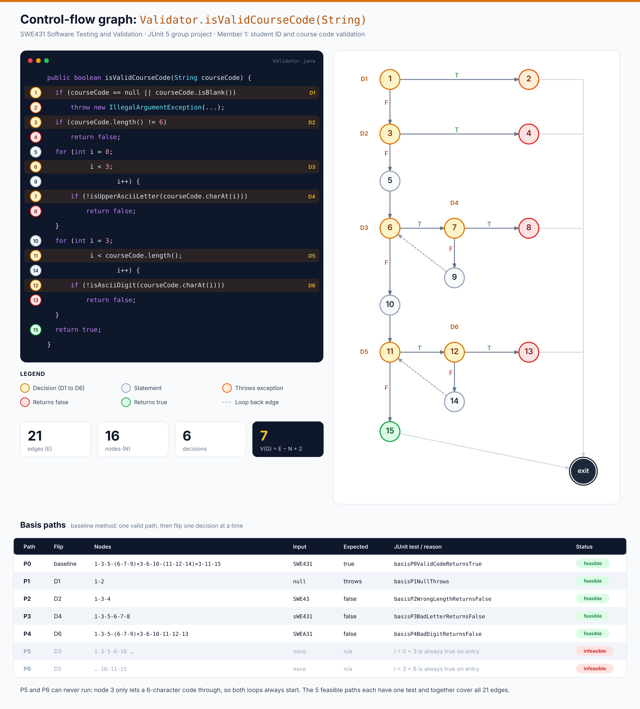

# Member 1: student ID and course code validation

## Rules

The rules come from the project skeleton (`Validator` Javadoc) and match the data the other members use in their tests (`20231234`, `SWE431`).

| Input | Valid when | Example |
|---|---|---|
| Student ID | exactly 8 ASCII digits (0-9) | `20231234` |
| Course code | exactly 3 uppercase ASCII letters (A-Z), then 3 ASCII digits | `SWE431` |

Missing input (null, empty, or only spaces) throws `IllegalArgumentException`. It means the caller forgot to pass a value, and `WithdrawalService` treats null the same way. Input that is present but in the wrong format returns `false`.

## Techniques and why

Equivalence partitioning: each input is split into classes that should behave the same (valid, wrong length, letter where a digit belongs, symbol, space, wrong case, non-ASCII, missing). One value per class is enough, because other values from the same class take the same path through the code.

Boundary value analysis: both rules are fixed lengths, and off-by-one mistakes happen at the edges, so every length is tested one shorter, exact and one longer.

| Part | Valid length | Lengths tested |
|---|---|---|
| Student ID | 8 | 7, 8, 9 (and 1) |
| Course code letters | 3 | 2, 3, 4 |
| Course code digits | 3 | 2, 3, 4 |

Value boundaries are covered too: `00000000`/`99999999` for IDs and `AAA000`/`ZZZ999` for codes are the lowest and highest characters allowed.

## Test cases (`ValidatorTest`)

### Student ID

| # | Input | Expected | Reason |
|---|---|---|---|
| 1 | `20231234` | true | 8 digits |
| 2 | `00000000` | true | all zeros is still 8 digits |
| 3 | `99999999` | true | highest digits |
| 4 | `2023123` | false | 7 digits, one short |
| 5 | `202312345` | false | 9 digits, one long |
| 6 | `2` | false | 1 digit |
| 7 | `2023123A` | false | letter at the end |
| 8 | `A0231234` | false | letter at the start |
| 9 | `2023-234` | false | symbol inside |
| 10 | `2023 234` | false | space inside |
| 11 | ` 2023123` | false | right length (8), starts with a space |
| 12-15 | null, `""`, `" "`, 8 spaces | throws | missing; 8 spaces has the right length, which shows the blank check runs before the length check |

### Course code

| # | Input | Expected | Reason |
|---|---|---|---|
| 1 | `SWE431` | true | valid |
| 2 | `AAA000` | true | lowest letters and digits |
| 3 | `ZZZ999` | true | highest letters and digits |
| 4 | `SW431` | false | 2 letters |
| 5 | `SWEN431` | false | 4 letters |
| 6 | `SWE43` | false | 2 digits |
| 7 | `SWE4310` | false | 4 digits |
| 8 | `swe431` | false | lowercase |
| 9 | `Swe431` | false | mixed case |
| 10 | `431SWE` | false | wrong order |
| 11 | `SWE4A1` | false | letter in the digit part |
| 12 | `S3E431` | false | digit in the letter part |
| 13 | `SWE-43` | false | symbol, right length |
| 14 | `SWE 43` | false | space, right length |
| 15 | `ÇSE431` | false | Turkish letter is not A-Z; `Character.isUpperCase` would accept it |
| 16-18 | null, `""`, 6 spaces | throws | missing |

`sampleDataUsedByTheTeamIsValid` checks that the IDs and codes the other members use in their tests pass validation, so the whole suite runs on valid data.

## Control-flow graph and basis paths: `isValidCourseCode`

Cyclomatic complexity: V(G) = E - N + 2 = 21 - 16 + 2 = 7, which matches 6 decisions + 1. Compound conditions (`||`) count as one decision node.

The basis set uses the baseline method: one path that returns true, then each decision flipped once.

| Path | Flipped | Nodes | Input | Expected | Test |
|---|---|---|---|---|---|
| P0 | baseline | 1-3-5-(6-7-9)x3-6-10-(11-12-14)x3-11-15 | `SWE431` | true | `basisP0ValidCodeReturnsTrue` |
| P1 | D1 | 1-2 | `null` | throws | `basisP1NullThrows` |
| P2 | D2 | 1-3-4 | `SWE43` | false | `basisP2WrongLengthReturnsFalse` |
| P3 | D4 | 1-3-5-6-7-8 | `sWE431` | false | `basisP3BadLetterReturnsFalse` |
| P4 | D6 | 1-3-5-(6-7-9)x3-6-10-11-12-13 | `SWEA31` | false | `basisP4BadDigitReturnsFalse` |
| P5 | D3 | 1-3-5-6-10-... | none | n/a | infeasible |
| P6 | D5 | ...-10-11-15 | none | n/a | infeasible |

P5 and P6 are infeasible. To get past node 3, the length must be exactly 6. So at the first check of D3, `i = 0 < 3` is always true, and at the first check of D5, `i = 3 < 6` is always true. Neither loop can be skipped. The 5 feasible paths each have one test, and together they cover all 21 edges.

## Regression test: defect D-01 (`ValidatorRegressionTest`)

The first version checked digits with `Character.isDigit(c)`. That method returns true for every Unicode digit, not only 0-9. So `٢٠٢٣١٢٣٤` (20231234 typed on an Arabic keyboard) was accepted as a valid student ID, and `SWE٤٣١` as a valid course code. Other parts of the system and the university database would treat these as different IDs.

The two regression tests fail with `Character.isDigit` and pass after the fix (`c >= '0' && c <= '9'`). They stay in the suite so the bug can't come back.

Evidence: `regression-before-fix.png` and `regression-after-fix.png` in this folder.

## Totals

41 test invocations: 15 student ID, 18 course code, 5 basis path, 1 shared data, 2 regression.

This part covers parameterized tests (`@CsvSource`, `@NullAndEmptySource`, `@ValueSource`), exception assertions with message checks, boundary values, a CFG with basis paths and an infeasible path, and the regression test.
